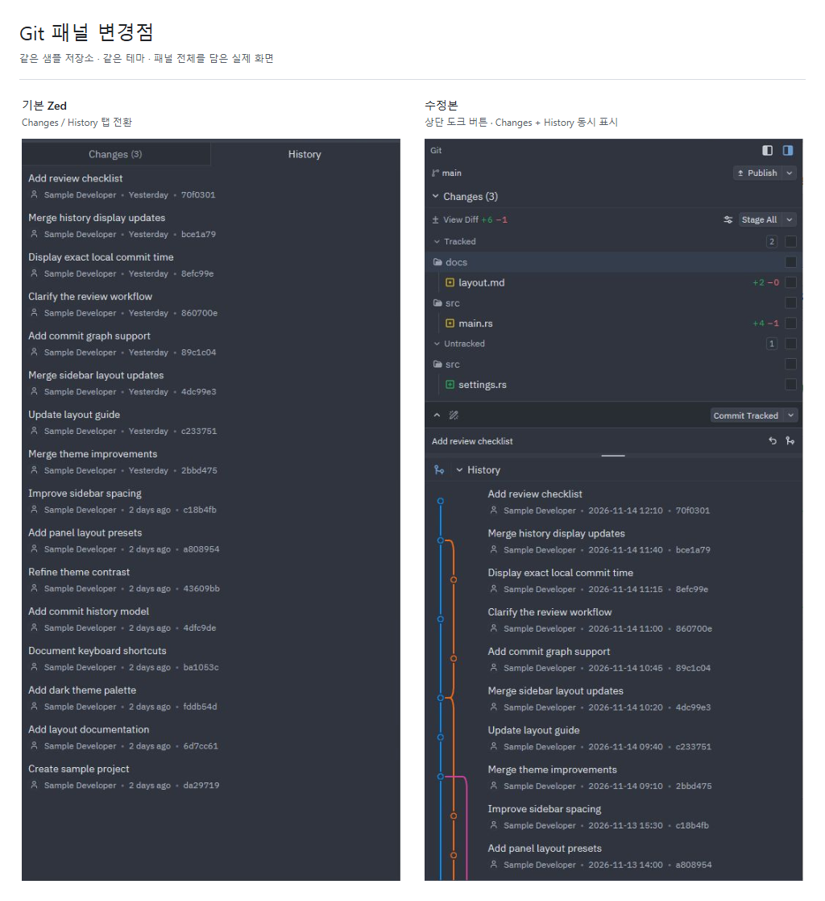
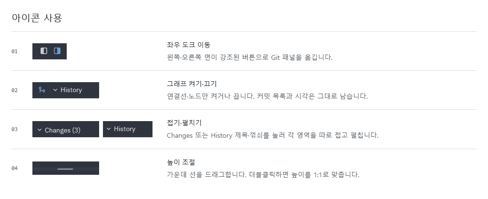

# Zed Git Layout

개인용으로 수정한 Windows Zed와 재설치·공유용 패키지를 관리하는 공개 저장소입니다. Zed Industries의 공식 배포판은 아닙니다.

## 다운로드와 설치

### [⬇ Windows 64비트 설치용 ZIP 다운로드 · 약 157MB](https://github.com/wow2658/zed-git-layout/releases/download/v1.28.1-custom.3/Zed-Git-Layout-1.28.1-custom.3-win-x64.zip)

**설치하려면 위 ZIP 하나만 받으면 됩니다.**

파일명: **`Zed-Git-Layout-1.28.1-custom.3-win-x64.zip`**

1. 위 링크에서 ZIP을 받아 **전체 압축 해제**합니다.
2. 압축을 푼 폴더의 **`Install.cmd`**를 실행합니다.
3. 기존 Zed 창을 닫고 **Zed Git Layout** 바로가기로 실행합니다.

새 개인 배포본도 같은 순서로 설치합니다. 이 배포본의 사용자 설정과 확장 데이터는 유지합니다. 소스와 라이선스도 ZIP에 들어 있으므로 다른 사람에게 전달할 때는 ZIP 전체를 전달합니다. 다운로드에는 GitHub 로그인이나 별도 접근 권한이 필요하지 않습니다.

릴리스에 있는 다른 파일은 무엇인가요?

설치용 ZIP에 검증 자료를 함께 올렸고, GitHub가 소스 압축파일 두 개를 자동으로 추가합니다. **아래 파일들은 일반 설치에 필요하지 않습니다.**

| 파일 | 용도 |
| --- | --- |
| `*-validation.json` | 빌드·실행·설치 검사 결과를 기록한 문서 |
| `*.zip.sha256` | 다운로드한 ZIP의 무결성을 확인하는 체크섬 |
| `Source code (zip)` / `Source code (tar.gz)` | GitHub가 자동으로 제공하는 개발용 소스 압축파일. 설치 프로그램은 포함하지 않습니다. |

현재 배포 버전은 **1.28.1-custom.3**, 기반 공식 버전은 **Zed 1.28.1**입니다. `custom.3`는 개발자 PC의 사용자명과 로컬 빌드 경로를 치환해 다시 빌드한 패키지입니다.

[전체 배포 이력](https://github.com/wow2658/zed-git-layout/releases) · [업데이트·빌드 방법](../docs/private-build.md)

## 개인 수정사항

<picture>
  <source media="(prefers-color-scheme: dark)" srcset="images/git-panel-comparison-dark.png">
  
</picture>

같은 샘플 저장소와 테마에서 캡처한 실제 화면입니다. 왼쪽은 공식 Zed 1.28.1의 History 탭, 오른쪽은 수정본입니다. 개인 프로젝트와 실제 작업 기록은 포함하지 않았습니다.

- Changes / History 상하 배치, 경계 드래그와 더블클릭 초기화
- 각 섹션 접기·펼치기 및 작업공간별 상태 저장
- 위쪽 저장소 선택기, 면이 강조된 좌우 패널 배치 아이콘
- History 목록의 커밋 그래프와 왼쪽 헤더의 표시 전환 버튼
- 각 커밋 시점의 PC 시간대 기준 `YYYY-MM-DD HH:mm` 표시

### 아이콘과 조작 방법

<picture>
  <source media="(prefers-color-scheme: dark)" srcset="images/git-panel-controls-dark.png">
  
</picture>

아이콘별 자세한 설명

| 번호 | 위치 | 조작과 결과 |
| --- | --- | --- |
| **1** | Git 패널 맨 위 오른쪽의 두 패널 아이콘 | 왼쪽 면이 강조된 아이콘은 **왼쪽 도크**, 오른쪽 면이 강조된 아이콘은 **오른쪽 도크**로 Git 패널을 옮깁니다. 현재 위치에 해당하는 버튼이 강조 표시됩니다. |
| **2** | History 제목 왼쪽의 그래프 아이콘 | 클릭할 때마다 **커밋 그래프의 연결선·노드**를 켜거나 끕니다. 커밋 목록과 날짜·시간은 계속 표시합니다. |
| **3** | Changes / History 제목 또는 제목 옆 꺾쇠 | 클릭한 **영역만 접거나 펼칩니다.** Changes와 History를 각각 조작할 수 있습니다. |
| **4** | Changes와 History 사이 가운데의 짧은 선 | **위아래로 드래그**하면 두 영역의 높이를 조절합니다. **더블클릭**하면 높이를 **1:1**로 맞춥니다. |

그래프 표시 전환과 History 영역 접기·펼치기는 별개입니다. 커밋 목록을 남긴 채 그래프만 숨기려면 **2번**을 사용합니다.

## 관리 방식

| 위치 | 내용 |
| --- | --- |
| `main` | 현재 개인 수정 소스와 배포 도구 |
| `v1.28.1-custom.3` 같은 태그 | 배포 ZIP의 소스 체크포인트 |
| Releases | 설치 ZIP, SHA-256, 검증 결과 |
| 로컬 `origin` | 이 저장소 |
| 로컬 `upstream` | 공식 [zed-industries/zed](https://github.com/zed-industries/zed) |

GitHub의 공개 fork와 별개의 저장소로 관리합니다. 공식 소스와의 Git 이력은 유지합니다. 큰 실행 파일·ZIP과 개인 로그인/설정 데이터는 소스 커밋에 넣지 않습니다.

## 공식 Zed 업데이트

필요할 때 공식 릴리스 태그를 가져와 별도 브랜치에서 병합하고, 개인 기능과 충돌을 해결한 뒤 다시 빌드해 새 Release를 만듭니다. 공식 업데이트가 우리 ZIP에 자동으로 반영되지는 않습니다.

지금 잘 쓰는 버전은 그대로 유지해도 됩니다. 필요한 기능이나 호환성 수정이 생겼을 때 반영하고, 보안 관련 수정은 별도로 확인합니다. 이전 ZIP과 태그는 복구용으로 보관합니다.

복사된 공식 운영용 workflow가 실행되지 않도록 이 저장소의 GitHub Actions는 꺼두었습니다. 자동 업데이트·자동 배포는 설정하지 않았습니다.

이 배포본은 미서명 개인 빌드입니다. 설치·재설치·제거는 Windows 11 x64의 임시 경로에서 검사했으며, 새 PC와 다른 GPU에서의 GUI 실행은 별도 확인이 필요합니다. 세부 검증 범위는 각 Release의 검증 JSON을 확인하세요.

원본 소프트웨어의 라이선스와 제3자 고지는 유지합니다. 원래 Zed의 소개는 [기존 README](../README.md)에 있습니다.
